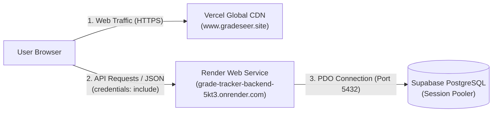

# Deployment & Project Context Handover

**Date:** November 13, 2026  
**Project:** GradeSeer (Academic Grade Tracker)  
**Primary Architecture:** Static Frontend (Vercel) + Containerized PHP/Apache API (Render) + PostgreSQL (Supabase)

---

## 1. System Architecture & Live URLs



| Service | Host / Platform | Live Endpoint / Domain | Status | Notes |
| :--- | :--- | :--- | :--- | :--- |
| **Frontend** | Vercel | [`https://www.gradeseer.site`](https://www.gradeseer.site) | 🟢 **Live** | Primary custom domain |
| **Frontend Redirect** | Vercel | [`https://gradeseer.site`](https://gradeseer.site) | 🟢 **Live** | 308 redirect to `www.gradeseer.site` |
| **Frontend Fallback** | Vercel | [`https://grade-tracker-frontend.vercel.app`](https://grade-tracker-frontend.vercel.app) | 🟢 **Live** | Default Vercel production deployment |
| **Backend API** | Render | [`https://grade-tracker-backend-5kt3.onrender.com/api`](https://grade-tracker-backend-5kt3.onrender.com/api) | 🟢 **Live** | Docker PHP 8.2 Apache container |
| **Database** | Supabase | `aws-0-ap-southeast-1.pooler.supabase.com:5432` | 🟢 **Connected** | PostgreSQL `postgres` |

---

## 2. Repositories Status & Locations

### A. Split Frontend (`grade-tracker-frontend`)
* **Local Path:** `c:\xampp\htdocs\split_grade_tracker\grade-tracker-frontend`
* **Remote:** `https://github.com/Sam14334/grade-tracker-frontend.git`
* **Branch:** `main` (merged with `esta` containing the modern UI)
* **Configuration:** [`js/config.js`](file:///c:/xampp/htdocs/split_grade_tracker/grade-tracker-frontend/js/config.js) is configured with:
  ```javascript
  window.APP_CONFIG = {
      apiBase: 'https://grade-tracker-backend-5kt3.onrender.com/api'
  };
  ```
* **Local Working Tree:** Unstaged improvements in `index.html` and `js/auth.js` replacing `action="#" method="POST"` with `onsubmit="submitLogin(event); return false;"` to eliminate static 405 fallback.

### B. Split Backend (`grade-tracker-backend`)
* **Local Path:** `c:\xampp\htdocs\split_grade_tracker\grade-tracker-backend`
* **Remotes:**
  * Active origin: `https://github.com/catsovercash/grade-tracker-backend.git`
  * Fork: `https://github.com/Sam14334/grade-tracker-backend.git`
* **Dockerfile:** Built on `php:8.2-apache`, listens on Render port `10000`, `AllowOverride All`, rewrites enabled.
* **Local Working Tree:** 1 unpushed commit `690aa17` containing `d41d8cd9.env` with plain-text credentials. Needs `git reset HEAD~1` before any remote push to keep secrets safe.

### C. Monolith Repository (Legacy / Backlog)
* **Local Path:** `c:\xampp\htdocs\grade_tracker`
* **Remote:** `https://github.com/Sam14334/grade_tracker.git` (branch: `nayan`)
* Contains the legacy non-split PHP monolith and previous sprint materials.

---

## 3. Key Issues Resolved During Session

1. **Vercel HTTP 405 on Monolith Repo:**
   * *Problem:* The original Vercel project (`gradetracker-gamma.vercel.app`) was serving a 4-week-old deployment from Oct 15 which had old PHP files (`php/login.php`). Vercel does not execute PHP scripts and blocks `POST` requests to static files.
   * *Fix:* Created a clean, dedicated Vercel project for `Sam14334/grade-tracker-frontend`.

2. **Branch Synchronization (`esta` vs `main`):**
   * *Problem:* The new UI commits lived on branch `esta`, which Vercel built as a private preview instead of promoting to production.
   * *Fix:* Merged `esta` into `main` on GitHub; Vercel automatically deployed the modern UI to production.

3. **Live Authentication & DB Verification:**
   * Successfully logged in on `grade-tracker-frontend.vercel.app` as student `micheal samia`. Verified that session cookies (`SameSite=None; Secure`), CSRF tokens, and database queries (`student_dashboard.html`, GWA analytics) executed cleanly.

4. **Namecheap DNS & Domain Parking Conflict:**
   * *Problem:* `gradeseer.site` initially had an active Namecheap "URL Redirect Record" pointing to `162.255.119.72`. This conflicted with Vercel's required A-record (`216.198.79.1`).
   * *Fix:* Deleted the conflicting URL Redirect Record in Namecheap Advanced DNS. Both `gradeseer.site` and `www.gradeseer.site` are now verified green in Vercel.

---

## 4. Immediate Open Items & Next Steps

### Task 1: Enable Multi-Origin Support in Backend (Code fixed locally — needs deploy)
* **Root Cause (verified against the live API):** [`src/bootstrap.php`](file:///c:/xampp/htdocs/split_grade_tracker/grade-tracker-backend/src/bootstrap.php) did an exact single-origin match. A live `OPTIONS` probe on `https://grade-tracker-backend-5kt3.onrender.com/api/auth/session` returned CORS headers only for `https://grade-tracker-frontend.vercel.app`; `https://www.gradeseer.site` and `https://gradeseer.site` received no `Access-Control-Allow-Origin`, so the browser blocked every request.
* **Implemented Code Update:**
  * [`src/config.php`](file:///c:/xampp/htdocs/split_grade_tracker/grade-tracker-backend/src/config.php) — new `appAllowedOrigins()` parses a comma-separated `APP_ALLOWED_ORIGIN`, trims spaces and trailing slashes, and de-duplicates.
  * [`src/bootstrap.php`](file:///c:/xampp/htdocs/split_grade_tracker/grade-tracker-backend/src/bootstrap.php) — echoes back the request origin when it is in the allow-list, always sends `Vary: Origin`, and keeps `Secure; SameSite=None` session cookies whenever any origin is configured.
* **Render Setting:** Set `APP_ALLOWED_ORIGIN` to (comma-separated, no spaces required):
  ```text
  https://www.gradeseer.site,https://gradeseer.site,https://grade-tracker-frontend.vercel.app
  ```
* **Verify After Redeploy:** `OPTIONS /api/auth/session` with `Origin: https://www.gradeseer.site` must return `Access-Control-Allow-Origin: https://www.gradeseer.site` and `Access-Control-Allow-Credentials: true`.
* **Note:** Cross-site session cookies (`onrender.com` cookie sent from `gradeseer.site`) are third-party cookies. Browsers that block them (Safari/iOS, Chrome with third-party cookies disabled) will drop the session even with CORS fixed. The durable fix is a same-origin proxy: a Vercel rewrite from `/api/(.*)` to the Render URL plus `apiBase: '/api'` in the frontend, which makes the cookie first-party and eliminates CORS entirely.

### Task 2: Safely Clean Backend Git History
* In `grade-tracker-backend`, run `git reset HEAD~1` to undo commit `690aa17` so `d41d8cd9.env` (containing Supabase credentials) is not pushed to GitHub. Ensure local `.env` is renamed to `.env` (ignored by `.gitignore`).

### Task 3: Commit Frontend Form Submissions Fix
* Commit the unstaged changes in `grade-tracker-frontend` (`index.html` and `js/auth.js`) so that forms cannot natively submit via POST if an unexpected error occurs.
